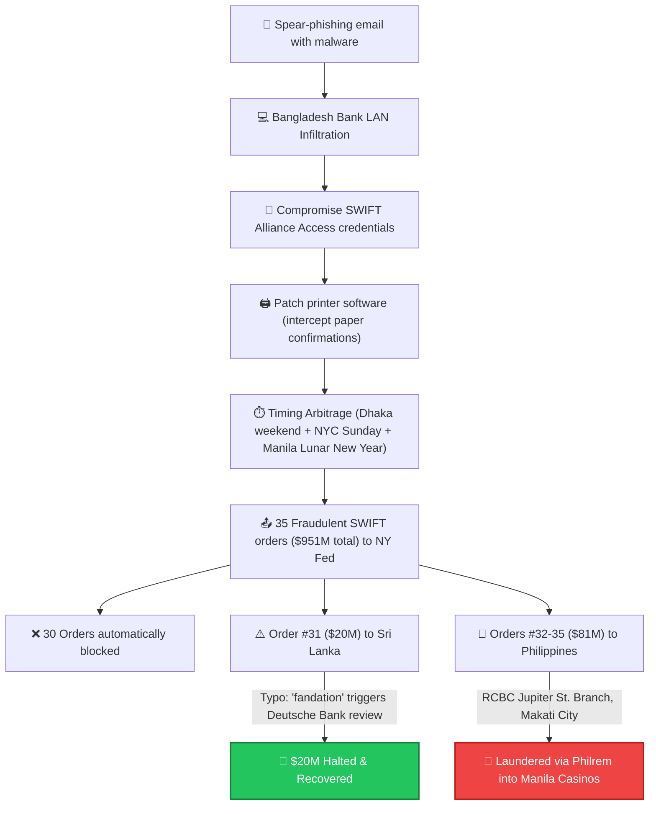
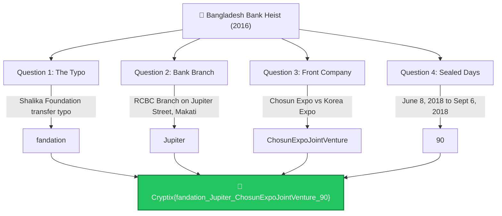

# Bangladesh Bank Cyber Heist — Cytech CTF Write-Up

<div align="center">


</div>

---

## 📋 Challenge Information

| Field | Detail |
| :--- | :--- |
| **Challenge Name** | Bangladesh Bank Cyber Heist |
| **Category** | OSINT / Cyber Threat Intelligence |
| **Target Organization** | Bangladesh Bank / Federal Reserve Bank of New York |
| **Threat Actor** | Lazarus Group (APT38 / Lab 110 / RGB) |
| **Primary Indicted Operative** | Park Jin Hyok (박진혁) |
| **Attempted Theft** | $951 Million USD (35 SWIFT orders) |
| **Actual Diverted Amount** | $101 Million USD ($20M halted, $81M laundered) |
| **Final Flag** | `Cryptix{fandation_Jupiter_ChosunExpoJointVenture_90}` |

---

## 🎯 Case Background & Threat Landscape

In February 2016, state-sponsored cyber actors affiliated with North Korea's **Lazarus Group** (also tracked as **APT38**, operating under Lab 110 of the Reconnaissance General Bureau) launched one of the most audacious financial cyberattacks in history against **Bangladesh Bank** (the central bank of Bangladesh).



### Attack Vector & Tactical Nuances
1. **Network Infiltration:** Attackers sent spear-phishing emails containing malicious attachments to bank personnel. Once an employee opened an attachment, custom loaders established command-and-control (C2) within Bangladesh Bank's internal network.
2. **Credential Theft:** The attackers harvested credentials for the bank's **SWIFT Alliance Access** financial messaging terminal.
3. **Printer Sabotage:** To prevent automated paper receipts from immediately alerting morning staff, the malware patched a system DLL (`evmsys.dll`) used by the bank's automated confirmation printer, suppressing physical confirmation slips.
4. **Calendar & Time Zone Arbitrage:** 
   - Attack launched Thursday night, February 4, 2016.
   - **Friday & Saturday:** Weekend in Muslim-majority Bangladesh (bank closed).
   - **Sunday:** Weekend in New York (Federal Reserve Bank of New York closed).
   - **Monday (Feb 8):** Chinese New Year national holiday in the Philippines (banks closed).
   - This tactical timing gave attackers a four-day head start before coordinated international communications could react.

---

## 🗺️ Investigation Flowchart



---

## 🔍 Step-by-Step Questions & Investigative Findings

### Question 1: What was the misspelled word?

> **Prompt:** *What was the misspelled word, exactly as the thieves wrote it?*

#### OSINT Investigation & Search:
* Queries used:
  ```text
  "Bangladesh Bank heist" "typo"
  "Bangladesh Bank heist" "misspelled"
  ```
* Findings:
  * The attackers issued payment instructions for a **$20 million** transfer to a purported Sri Lankan non-profit entity named the **"Shalika Foundation"** (founded by Shalika Perera).
  * In the SWIFT routing instructions, the hackers spelled the beneficiary name as:
    ```text
    Shalika fandation
    ```
  * Instead of the correct English spelling:
    ```text
    foundation
    ```
  * Routing intermediary bank **Deutsche Bank** detected the typographic anomaly and halted the processing to request manual clarification from Bangladesh Bank.
  * Concurrently, Pan Asia Banking Corp in Sri Lanka flagged the transaction due to the unusually massive volume for a private NGO. The transfer was canceled, and the full $20 million was reclaimed.

**Answer 1:**
```text
fandation
```

---

### Question 2: Most of the stolen money went to one bank branch

> **Prompt:** *Most of the stolen money landed in one bank branch in another country. That branch is named after a street, and that street is named after a planet. Which planet?*

#### OSINT Investigation & Search:
* Queries used:
  ```text
  "Bangladesh Bank heist" "$81 million" "branch" "street"
  ```
* Findings:
  * Four transfers totaling **$81 million** cleared the Federal Reserve Bank of New York and were routed to the Philippines.
  * **Receiving Financial Institution:** Rizal Commercial Banking Corporation (RCBC).
  * **Branch Location:** Makati City, Metro Manila.
  * **Street Address:** **Jupiter Street** (Makati City).
  * **Background on the Accounts:**
    * In May 2015 (nine months prior to the heist), four US dollar accounts were opened at the RCBC Jupiter Street branch under fictitious identities: *Michael Francisco Cruz*, *Jessie Christopher Lagrosas*, *Alfred Santos Vergara*, and *Enrico Teodoro Vasquez*.
    * The accounts remained dormant with a minimal $500 balance until February 4, 2016, when the $81 million landed.
    * Branch manager Maia Santos-Deguito facilitated rapid withdrawals and transfers into foreign exchange broker **Philrem Service Corp**.
    * The funds were converted to cash and gaming chips and funneled through Manila's **Solaire Resort & Casino** and **Midas Hotel & Casino** to junket operators (*Kim Wong*, *Weikang Xu*), exploiting anti-money laundering (AML) loopholes that exempted Philippine casinos at the time.
  * The street is named after the planet **Jupiter**.

**Answer 2:**
```text
Jupiter
```

---

### Question 3: Man charged years later

> **Prompt:** *Years later, a man was charged for his role. Investigators say he worked for a company that used two names. Bring us the one that doesn’t carry the country’s common name. (no spaces)*

#### OSINT Investigation & Search:
* Queries used:
  ```text
  "Bangladesh Bank heist" "charged" "DOJ" "complaint" "company"
  ```
* Findings:
  * In 2018, the United States Department of Justice unsealed a sweeping 179-page criminal complaint against North Korean operative **Park Jin Hyok** (박진혁), charging him with conspiracy to commit wire fraud and computer-related fraud for:
    * The 2014 Sony Pictures Entertainment cyberattack.
    * The 2016 Bangladesh Bank cyber heist.
    * The 2017 global WannaCry ransomware outbreak.
  * Park operated under the cover of a state-owned front organization:
    1. **Korea Expo Joint Venture** (KEJV)
    2. **Chosun Expo Joint Venture** (조선엑스포합영회사)
  * Linguistic & Geopolitical Context:
    * *"Korea"* is the common international English exonym.
    * *"Chosun"* (Joseon / 조선) is the historical and traditional Korean name used domestically by the Democratic People's Republic of Korea (DPRK).
  * The prompt specifies: *the one that doesn't carry the country's common name, without spaces*.
    ```text
    ChosunExpoJointVenture
    ```

**Answer 3:**
```text
ChosunExpoJointVenture
```

---

### Question 4: Charges filed under seal

> **Prompt:** *The charges against him were filed in secret, then revealed to the world. How many days were they hidden?*

#### Primary Court Docket Investigation:
* **Court Case:** *United States of America v. Park Jin Hyok*
* **Court:** U.S. District Court for the Central District of California
* **Case Number:** `2:18-mj-01479-DUTY`
* **Docket Link:** [CourtListener Docket 7833295](https://www.courtlistener.com/docket/7833295/united-states-v-hyok/)
* **Date Filed Under Seal:** **June 8, 2018**
* **Date Formally Unsealed:** **September 6, 2018**

#### Day Count Calculation:

| Month Span | Calculation | Total Days |
| :--- | :--- | :---: |
| **June** (Remaining days after June 8) | $30 - 8$ | **22 days** |
| **July** (Full calendar month) | 31 | **31 days** |
| **August** (Full calendar month) | 31 | **31 days** |
| **September** (Days up to September 6) | 6 | **6 days** |
| **Total** | $22 + 31 + 31 + 6$ | **90 days** |

*Alternative date-to-date calculation:*
* June 8 $\to$ July 8: $30\text{ days}$
* July 8 $\to$ August 8: $31\text{ days}$
* August 8 $\to$ September 6: $29\text{ days}$
* $30 + 31 + 29 = 90\text{ days}$

#### Verification via Python CLI:
```bash
python3 -c '
from datetime import date
sealed_date = date(2018, 6, 8)
unsealed_date = date(2018, 9, 6)
delta = unsealed_date - sealed_date
print(f"Days hidden: {delta.days}")
'
# Output: Days hidden: 90
```

**Answer 4:**
```text
90
```

---

## 🚩 Flag Assembly & Submission Log

Combining all four answers with underscores:
* **Answer 1:** `fandation`
* **Answer 2:** `Jupiter`
* **Answer 3:** `ChosunExpoJointVenture`
* **Answer 4:** `90`

### Submission Notes & Guessing Log:
```text
Wrong flag.. maybe a spelling mistake?:
Cryptix{fundation_Jupiter_ChosunExpoJointVenture_90}

Cryptix{Fandation_Jupiter_ChosunExpo_90}

thanks for the brute force guess, mr general manager!
```

### ✅ Accepted Final Flag:
```text
Cryptix{fandation_Jupiter_ChosunExpoJointVenture_90}
```

---

## 📚 Primary Sources & Official Disclosures

* **Wikipedia:** [Bangladesh Bank robbery](https://en.wikipedia.org/wiki/Bangladesh_Bank_robbery)
* **Reuters Report:** [How a hacker's typo helped stop a billion-dollar bank heist](https://www.reuters.com/article/us-usa-fed-bangladesh-typo-insight/how-a-hackers-typo-helped-stop-a-billion-dollar-bank-heist-idUSKCN0WC0TC/)
* **U.S. Department of Justice:** [North Korean Regime-Backed Programmer Charged With Conspiracy to Conduct Multiple Cyberattacks](https://www.justice.gov/usao-cdca/pr/north-korean-regime-backed-programmer-charged-conspiracy-conduct-multiple-cyberattacks)
* **CourtListener:** [Docket for United States v. Hyok (2:18-mj-01479)](https://www.courtlistener.com/docket/7833295/united-states-v-hyok/)
* **Federal Bureau of Investigation (FBI):** [Cyber's Most Wanted: Park Jin Hyok](https://www.fbi.gov/wanted/cyber/park-jin-hyok)
* **U.S. Department of the Treasury:** [Treasury Sanctions North Korean State-Sponsored Malicious Cyber Groups](https://home.treasury.gov/news/press-releases/sm774)
