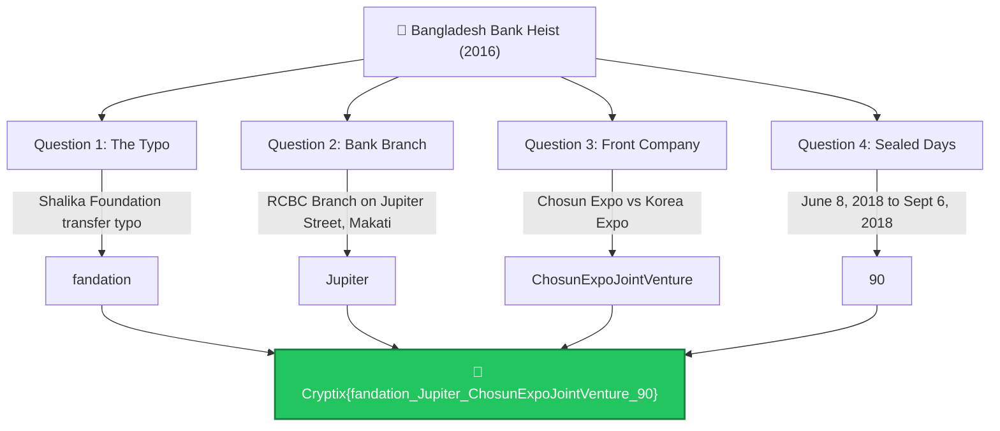

# Bangladesh Bank Cyber Heist — Cytech CTF Write-Up

<div align="center">


</div>

---

## 📋 Challenge Information

| Field | Detail |
| :--- | :--- |
| **Challenge Name** | Bangladesh Bank Cyber Heist |
| **Category** | OSINT / Cyber Threat Intelligence |
| **Target Organization** | Bangladesh Bank / Federal Reserve Bank of New York |
| **Threat Actor** | Lazarus Group (APT38) / Park Jin Hyok |
| **Final Flag** | `Cryptix{fandation_Jupiter_ChosunExpoJointVenture_90}` |

---

## 🎯 Investigation Overview

This challenge investigates the infamous **2016 Bangladesh Bank cyber heist** where cybercriminals attempted to steal nearly $1 billion via fraudulent SWIFT payment orders. 

The goal is to answer four specific historical and investigative questions based on public news records, primary disclosures, and DOJ criminal indictments to reconstruct the final flag:

```text
Cryptix{<Question1>_<Question2>_<Question3>_<Question4>}
```

---

## 🗺️ Investigation Flowchart



---

## 🔍 Step-by-Step Questions & Investigative Findings

### Question 1: What was the misspelled word?

#### Investigation & Search:
* Queries used:
  ```text
  "Bangladesh Bank heist" "typo"
  "Bangladesh Bank heist" "misspelled"
  ```
* Found the $20m transfer to a fake Sri Lankan non-profit named **"Shalika Foundation"**.
* The attackers misspelled **"foundation"** as:
  ```text
  fandation
  ```
* Instead of:
  ```text
  foundation
  ```
* Deutsche Bank (the routing bank) noticed the typo and flagged the transaction for manual review, preventing subsequent fraudulent transfers and halting hundreds of millions of dollars.

**Answer 1:**
```text
fandation
```

---

### Question 2: Most of the stolen money went to one bank branch

#### Investigation & Search:
* Queries used:
  ```text
  "Bangladesh Bank heist" "$81 million" "branch"
  ```
* $81 million was successfully routed to the Philippines.
* **Bank:** Rizal Commercial Banking Corporation (RCBC)
* **Branch:** Makati City
* **Street:** Jupiter Street (named after the planet Jupiter)

**Answer 2:**
```text
Jupiter
```

---

### Question 3: Man charged years later

Need the company name that doesn't use the country's common name.

#### Investigation & Search:
* Queries used:
  ```text
  "Bangladesh Bank heist" "charged" "DOJ" "company"
  ```
* Found North Korean programmer **Park Jin Hyok** (member of Lazarus Group / APT38).
* Worked for a North Korean government front company operating under two names:
  1. `Korea Expo Joint Venture`
  2. `Chosun Expo Joint Venture`
* *Korea* = country's common name.
* *Chosun* = traditional Korean name.
* We need the one without the country's common name. Removing spaces:
  ```text
  ChosunExpoJointVenture
  ```

**Answer 3:**
```text
ChosunExpoJointVenture
```

---

### Question 4: Charges filed under seal

Need to find how many days they were hidden.

#### Court Docket:
* Case: **United States v. Park Jin Hyok** (Docket No. 2:18-mj-01479 / CourtListener Docket 7833295)
* **Filed Under Seal:** June 8, 2018
* **Unsealed:** September 6, 2018

#### Verification via Terminal / Python:
```bash
python3 -c '
from datetime import date
d1 = date(2018, 6, 8)
d2 = date(2018, 9, 6)
print(f"Total days: {(d2 - d1).days}")
'
```

#### Manual Breakdown:
* June 8 → July 8 = 30 days
* July 8 → August 8 = 31 days
* August 8 → September 6 = 29 days
* **Total:** $30 + 31 + 29 = 90\text{ days}$

*(Or by month: June: $30 - 8 = 22\text{ days}$; July: 31 days; August: 31 days; September: 6 days $\implies 22 + 31 + 31 + 6 = 90\text{ days}$)*

**Answer 4:**
```text
90
```

---

## 🚩 Flag Assembly & Submission Log

Putting everything together:
* Answer 1: `fandation`
* Answer 2: `Jupiter`
* Answer 3: `ChosunExpoJointVenture`
* Answer 4: `90`

### Submission Notes & Guessing Log:
```text
Wrong flag.. maybe a spelling mistake?:
Cryptix{fundation_Jupiter_ChosunExpoJointVenture_90}

Cryptix{Fandation_Jupiter_ChosunExpo_90}

thanks for the brute force guess, mr general manager!
```

### ✅ Accepted Final Flag:
```text
Cryptix{fandation_Jupiter_ChosunExpoJointVenture_90}
```

---

## 📚 Primary Sources & Intelligence Records

* [Wikipedia — Bangladesh Bank robbery](https://en.wikipedia.org/wiki/Bangladesh_Bank_robbery)
* [Reuters — How a hacker's typo helped stop a billion-dollar bank heist](https://www.reuters.com/article/us-usa-fed-bangladesh-typo-insight/how-a-hackers-typo-helped-stop-a-billion-dollar-bank-heist-idUSKCN0WC0TC/)
* [U.S. Department of Justice — North Korean Regime-Backed Programmer Charged](https://www.justice.gov/usao-cdca/pr/north-korean-regime-backed-programmer-charged-conspiracy-conduct-multiple-cyberattacks)
* [CourtListener Docket — United States v. Hyok (Docket 7833295)](https://www.courtlistener.com/docket/7833295/united-states-v-hyok/)
* [FBI Cyber Most Wanted — Park Jin Hyok](https://www.fbi.gov/wanted/cyber/park-jin-hyok)
